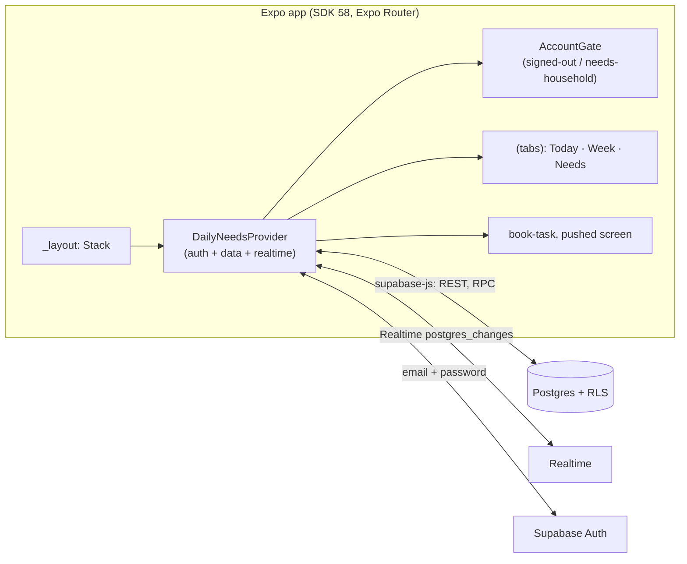
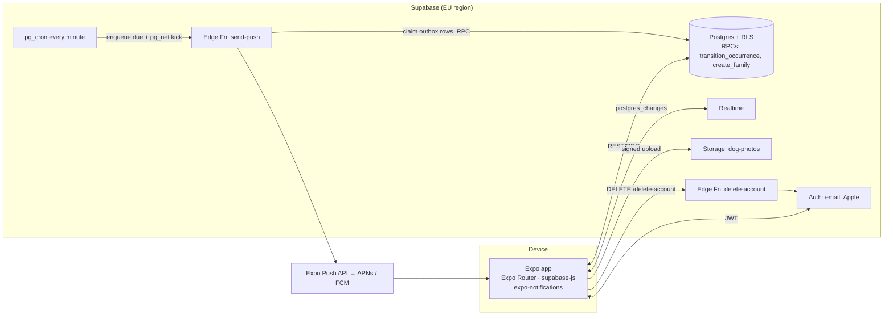
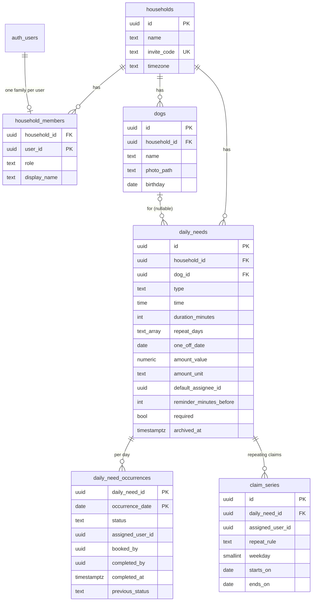
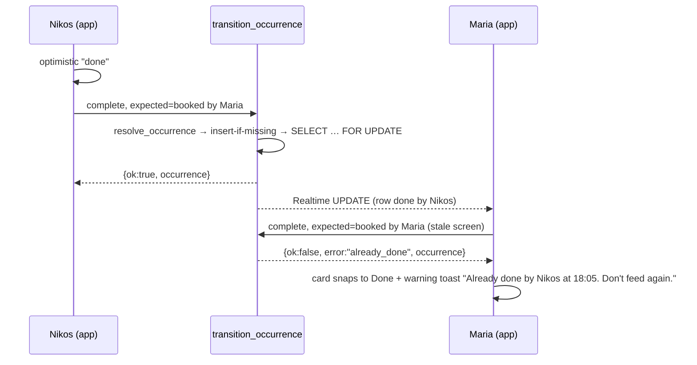
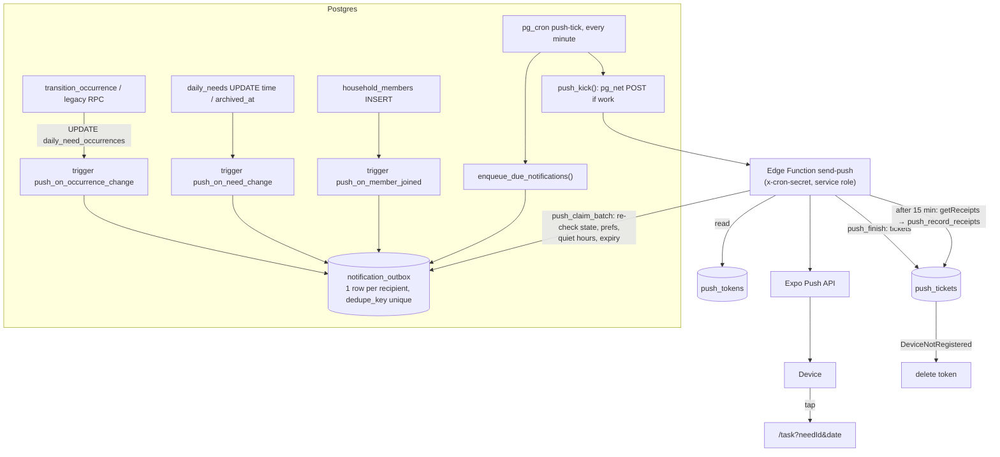

# Architecture

Owner: engineer · Draft v1 · 2026-10-13 · Inputs: `.claude/agents/docs/product-brief.md`, `docs/business/mvp-scope.md`, `docs/roadmap.md`, `docs/design/user-flows.md`, `docs/design/screens.md`

## Headline decisions

1. **Stay on Supabase** (Postgres + RLS + Realtime + Auth), add **Edge Functions + `pg_cron`** for push and account deletion. There is no other backend.
2. **All writes to task state go through one guarded RPC**, `transition_occurrence`. The client sends the state it saw (`expected_status`, `expected_actor`). The server locks the row, compares, and either applies the change or returns a typed conflict (`already_claimed`, `already_done`, `state_changed`, `not_allowed`) with the current row. This is the double-feeding guard.
3. **Repeating claims are data, not inference.** "Every Thu" / "Every day" claims live in `claim_series`. A day's state resolves as: stored row → active series → the task's default assignee → open. The same resolver runs in SQL (`resolve_occurrence`) and TypeScript (`src/lib/tasks.ts`).
4. **`dogs` table now, one dog per family in the UI.** `daily_needs.dog_id` is nullable and auto-filled, so v1.1 multi-dog is a UI change.
5. **Names are resolved on the server** (`household_members.display_name` → Apple/auth metadata → email prefix). The client no longer sends an actor name.
6. **Tasks are soft-deleted** (`archived_at`) so History keeps past occurrences.
7. **Push is server-scheduled** (built, §8): triggers and a minute-level `pg_cron` job write a per-recipient outbox; the `send-push` Edge Function drains it through the Expo Push API.
8. **i18n:** a small typed string table (`src/i18n`) with `Intl` date formatting. English ships first. Greek is wired but switched off until the dictionary is complete and reviewed.

## 1. As built (before this change)

- One context provider (`src/hooks/use-daily-needs.tsx`) owns the session, the family, needs, occurrences and one Realtime channel per family.
- Tables: `households`, `household_members` (unique `user_id`, so one family per user), `daily_needs`, `daily_need_occurrences` (PK `(daily_need_id, occurrence_date)`; a missing row means "open").
- Problems found:
  - `set_daily_need_occurrence` was last-write-wins (only a booked-by-someone-else check on booking). Two people could both mark dinner done.
  - The client sent `actor_name` (an email prefix), which any member could spoof.
  - Repeating bookings were inferred from "the latest earlier row". Week showed them but Today did not, and releasing one day ended the whole series.
  - Deleting a need cascaded to its occurrences, which would erase history.
  - A Supabase token refresh (`onAuthStateChange`) flipped the app to the loading gate, which unmounted the navigator.
  - UI: booked rows were orange dashed (the mockups use that for *open*), "Book" only appeared for future walks, and dates were hard-coded to `en-GB`.

## 2. Target MVP architecture

**Client layout** (what this change introduced):

| Area | Files |
|---|---|
| Routes | `src/app/(tabs)/{index,week,routine}.tsx`, `src/app/task.tsx` (form sheet; deep-link target `dogschedule://task?needId=…&date=…`) |
| State | `src/hooks/use-daily-needs.tsx` (auth, family, data, Realtime, optimistic `transition`), `src/hooks/use-task-actions.ts` (outcome → toast / inline message), `src/hooks/use-push.tsx` (permission, token, preferences, notification taps) |
| Domain | `src/lib/tasks.ts` (types, resolver, timing, amounts), `src/lib/push.ts` (expo-notifications setup, token register/unregister), `src/lib/database.types.ts` (hand-written DB types) |
| Server | `supabase/migrations/*.sql`, `supabase/functions/send-push/` (Deno Edge Function + notification copy) |
| UI | `today-list`, `week-screen`, `routine-screen`, `task-sheet`, `task-editor`, `account-gate`, `toast`, `task-ui`, interim `account-sheet` |
| Tokens / i18n | `src/constants/theme.ts` (`Palette`, `MemberColors`), `src/i18n/{index,strings}.ts` |

Next structural step (with the onboarding wizard): replace `AccountGate` with an `(onboarding)` route group and split the provider into `AuthProvider` and `FamilyDataProvider`. Not done now because the wizard screens are NEW scope.

## 3. Data model

Notes:

- **Enums are check-constrained `text`**, mirrored as TS unions in `database.types.ts`. Adding a value is a constraint swap, not `ALTER TYPE`. `type ∈ walk, food (UI "Meal"), medicine, potty, play, grooming, vet, other`. `amount_unit ∈ g, ml, cup, pill, drop`.
- **One-off tasks** (vet, grooming appointments): `one_off_date` set means "only on that date". `repeat_days` is kept so the task can be made repeating again.
- **Default assignee** ("Usually done by") is a virtual claim. Nothing is written until someone acts. The assignee can Release that day.
- **Status names:** the DB keeps `booked`. The UI says "Claimed" (screens.md §1). The code keeps `daily_needs` and `households`; the UI says Task and Family.
- **Display names** are denormalised into occurrence rows (`assigned_name`, `completed_name`) at write time, so history survives account deletion ("Former member" when the user id is null).
- **Dates and times** are the family's local wall clock (`time without time zone`, `date`). `households.timezone` (IANA, nullable; `family_timezone()` falls back to `Europe/Athens`) is set from the first device that opens the app after creating the family or after the push migration (`set_family_timezone`; only the owner can change a set value). Push due times and quiet hours use it; see §8.
- **Legacy:** `daily_need_occurrences.repeat_rule` and `get_latest_household_occurrences` are no longer read by this app version. They stay for older builds and can be dropped once those builds are retired.

## 4. Guarded state transitions

`transition_occurrence(target_need_id, target_date, target_action, expected_status, expected_actor?, target_member_id?, target_repeat_rule?, target_reminder_enabled?, target_release_scope?) → jsonb`

| Action | From | Result | Extra rules |
|---|---|---|---|
| `claim` | open | booked by `target_member_id` (default: me) | `daily` / `weekday` also writes a `claim_series` row and ends overlapping series |
| `take_over` | booked | booked by me (or the chosen member) | UI confirms first; push to the previous claimer |
| `release` | booked | open | Claimer (or whoever assigned it) only, else `not_allowed`. `target_release_scope = 'series'` also ends the claimer's series from tomorrow |
| `complete` | open / booked | done, `previous_status` saved | Claimer is kept so Undo can restore the claim |
| `undo` | done | `previous_status` | Completer only (the 5 s snackbar plus the card button until midnight) |
| `reopen` | done | `previous_status` | Anyone ("Mark as not done", with a confirm in the sheet); push to the completer |

Result: `{ ok, error, occurrence }`. `expected_actor` is compared with `assigned_user_id` for `booked` and with `completed_by` for `done`. Mismatch mapping: current `done` → `already_done`; current `booked` and the caller expected open (or is claiming) → `already_claimed`; anything else → `state_changed`. Auth, membership and validation problems raise exceptions instead.

Concurrency: if no row exists, the RPC first inserts the *effective* state (`ON CONFLICT DO NOTHING`), then takes a row lock. Two simultaneous callers serialise on the primary key and then the lock, and the second sees the first one's result.

Client: `transition()` in the provider applies an optimistic row, calls the RPC, and then stores the server row (success or conflict) or rolls back on a network error. `useTaskActions` turns the outcome into the copy from screens.md §1. The task sheet shows conflicts inline, because a native form sheet covers the toast layer.

## 5. Row Level Security

- Every table has RLS on. Membership is checked with `is_household_member(household_id)`, a `security definer` function, so policies don't recurse.
- Reads: members can read their family's `households`, `household_members`, `dogs`, `daily_needs`, `daily_need_occurrences` and `claim_series`.
- Writes from the client: `daily_needs` (insert/update/delete; the app soft-deletes) and `dogs` (update). Everything else goes through `security definer` RPCs that check `auth.uid()` and membership: `create_family`, `join_household`, `set_my_display_name`, `transition_occurrence`.
- A trigger (`daily_needs_before_write`) keeps `dog_id` and `default_assignee_id` inside the same family.
- Internal helpers (`member_display_name`, `resolve_occurrence`, `end_claim_series`) have `EXECUTE` revoked from `anon` and `authenticated`. Supabase's default privileges grant both, so every new public function must revoke `anon` explicitly.
- Storage (with Dog profile edit): a private bucket `dog-photos`, path `{household_id}/{dog_id}.jpg`, with a policy that uses `is_household_member` on the first path segment. Reads use signed URLs.

## 6. Realtime

One channel per family (`household-{id}`), with `postgres_changes` on `daily_needs`, `daily_need_occurrences`, `claim_series` and `dogs` (UPDATE), filtered by `household_id`. RLS applies to Realtime as well. On `CHANNEL_ERROR` the app shows a toast. **Gap:** there is no resync after reconnect yet. Add a refetch of today's rows when the channel goes `SUBSCRIBED` after an error, and on `AppState` → active.

## 7. Auth

- Email + password with **separate Sign in / Create account**, a **16+ checkbox** (stored as `user_metadata.age_confirmed`, self-declared), a **check-email** state with Resend, and **password reset** through `resetPasswordForEmail` and the app deep link (`dogschedule://…#access_token…&type=recovery` → `setSession` → "Choose a new password").
- **Sign in with Apple** (iOS): `expo-apple-authentication` → `supabase.auth.signInWithIdToken({ provider: 'apple' })`. On the first sign-in the Apple name is saved to `user_metadata.full_name`, which `member_display_name` reads. Accounts without `age_confirmed` (older accounts, or Apple sign-in from the Sign in tab) see a one-time age confirmation.
- Session handling: the app only reloads data when the **user id** changes, so token refreshes no longer remount the app.
- Dashboard setup: redirect URLs `dogschedule://**` (and the dev-client scheme), plus the Apple provider with the bundle ID. See README.

## 8. Push notifications

Built in `202610150001_push_notifications.sql`, `supabase/functions/send-push/` and `src/lib/push.ts` / `src/hooks/use-push.tsx`. Not yet run against a Supabase project or real devices (README has the setup).

**Tables.** `push_tokens(user_id, expo_token unique, platform, locale)`; read-own RLS, written only through `register_push_token` (upsert by token, so a phone that switches accounts moves to the new user) and `unregister_push_token` (sign-out). `notification_preferences(user_id, claimed_tasks, open_tasks, overdue_tasks, family_activity 'off'|'must_do'|'all', new_members)`; own-row RLS, no row = defaults (all on, family activity for must-do tasks). `notification_outbox` and `push_tickets` have RLS on with no policies and no grants: only `security definer` functions and the service role touch them. (The design's separate `notification_log` became the outbox's unique `dedupe_key`.)

**What is queued, and for whom**

| Kind | Source | Recipients | Preference | Quiet hours |
|---|---|---|---|---|
| `claimer_reminder` | cron, due − `reminder_minutes_before`, if the claim's reminder is on and the claim existed before that moment | Claimer | My claimed tasks | **Bypassed** |
| `must_do_unclaimed` | cron, due − 60 min, must-do and open | Everyone | Open tasks | Skipped if 07:00 is after due |
| `due_unclaimed` | cron, at due time, open | Everyone | Open tasks | Skipped if 07:00 is after overdue |
| `overdue` | cron, due + grace (duration, 30–60 min), not done | Claimer; must-do: everyone | Overdue tasks | Skipped if 07:00 is the next day |
| `assigned` | trigger: claim / take over for someone else | New claimer | My claimed tasks | Deferred to 07:00 |
| `taken_over` | trigger: claimer changed by someone else | Previous claimer | My claimed tasks | Deferred |
| `done_on_your_claim` | trigger: done by someone other than the claimer (sent after 30 s so a 5 s Undo cancels it) | Claimer | My claimed tasks | Deferred |
| `family_done` | trigger: done (30 s delay) | Everyone else | Family activity (must-do only by default) | Deferred, until midnight |
| `released_near_due` | trigger: release from 30 min before due until overdue | Everyone else | Open tasks | Skipped if stale |
| `reopened` | trigger: "Mark as not done" by someone else | Completer | My claimed tasks | Deferred |
| `member_joined` | trigger: `household_members` insert | Existing members | New members | Deferred |
| `task_deleted` / `task_moved` | trigger: task archived / time changed while someone has today's claim | Today's claimer | My claimed tasks | Deferred |

- **Dedupe:** scheduled kinds use `kind:need:date:HHMM:recipient` (moving a task re-arms its reminders); event kinds add the transition timestamp. Inserts use `on conflict (dedupe_key) do nothing`, so cron overlaps and retries never double-send. Each scheduled push fires only inside a 15-minute window after its trigger time, so a late cron run catches up but never sends stale alerts.
- **Cancel on state change:** the occurrence trigger marks pending rows `skipped (state_changed)` when they no longer fit the new state (`push_is_relevant`: reminder only while the recipient still holds the claim, "nobody's on it" only while open, overdue only while not done, done-notices only while done). Archiving a task skips all its pending rows. `push_claim_batch` re-checks the same rules, the task time, membership, preferences and expiry at send time, so a push that slipped through is skipped rather than sent.
- **Quiet hours:** 23:00–07:00 in the family time zone. Rows are deferred to 07:00, or skipped when they would be stale by then (`expires_at`). Only claimer reminders bypass.
- **Actor:** triggers read `auth.uid()` of the transaction (the RPC caller), so nobody is notified about their own action. Changes without a JWT (SQL editor, service role) notify everyone relevant.
- **Sending:** `push_kick()` (pg_net) only calls the function when rows are due or receipts are pending. The function authenticates the call with the `x-cron-secret` header (deployed with `--no-verify-jwt`), claims ≤ 100 rows per round (`for update skip locked`, stuck `sending` rows return after 5 min, max 3 attempts), renders copy per device locale (`templates.ts`; English only until Greek is reviewed), sends in chunks of 100 with exponential backoff on 429/5xx, and records tickets. Receipts are fetched 15 min–24 h later; `DeviceNotRegistered` (ticket or receipt) deletes the token. `push_cleanup()` prunes daily.
- **Message:** `title`, `body`, `data: { url: "/task?needId&date", kind, needId, date }`, Android `channelId` `reminders` (HIGH: reminder, unclaimed, overdue, released) or `activity` (DEFAULT), `priority: high` and `expiration` for time-sensitive kinds, iOS `threadId` per task.
- **Client:** `configureNotifications()` runs at startup (handler: banner + list + sound, no badge; Android channels). Permission is never requested at launch: after the user's first own claim a toast offers **Turn on** (once per device), and the interim account sheet (Routine → gear) has the OS status row, **Turn on reminders** / **Open settings**, the five preferences, the quiet-hours note and the Android battery hint. With permission, the app registers the Expo push token on start, on return to foreground and when the OS rolls it; sign-out unregisters it first. Taps (including the one that cold-started the app, via `getLastNotificationResponse`) open the task sheet once the navigator and tasks are loaded.
- **Not built:** notification action buttons ("I'll do it" / "Done"). In SDK 58 a background action only runs JS on Android (`registerTaskAsync`); on iOS it needs `opensAppToForeground`, which is no better than tapping the body. Revisit with a Notification Content/Service extension or when the background path covers iOS. The "Reminders are off" banner on Today, the full-screen priming screen (#10, part of onboarding), solo nudges (+24 h / +60 h) and a custom notification icon (Android 96×96 white PNG via the plugin's `icon`) are also not built.

## 9. Internationalisation

- `src/i18n/strings.ts` holds the typed keys (`en` complete, `el` partial from screens.md §1). `t(key, params)` interpolates, `tPlural` uses `Intl.PluralRules`, and `toDisplayUpperCase` strips Greek tonos for ALL-CAPS labels.
- Language comes from the device (`expo-localization`) and is limited to `enabledLanguages` (currently `["en"]`). Adding `"el"` turns Greek on. The Language setting (screens.md #23) will call `setLanguage` and persist the choice.
- Dates and times always go through `Intl.DateTimeFormat` with `en-GB` or `el-GR` (24-hour clock). No hard-coded locale remains in the screens.
- Copy avoids name + gendered article ("Claimed: Maria"). Buttons allow two lines or wider widths for Greek.
- **Fonts:** the mockups use Bricolage Grotesque and DM Sans, which (to our knowledge) have no Greek glyphs. iOS and Android fall back per glyph to the system font, so mixed-script lines would look patchy. Plan: load both fonts with `expo-font` for `en` only, and use the system font (SF Pro / Roboto) for the whole UI when the language is `el`. Revisit with Manrope / Commissioner / Noto Sans Display if a single family is wanted. The fonts are not loaded yet; the app still uses the system font.

## 10. Offline behaviour

- **Now:** data lives in memory. On a cold start without network the app shows the error gate with Try again. A failed action rolls back its optimistic change and shows "Couldn't save. Try again" with Retry. Nothing is queued, on purpose: queued claims create false certainty (user-flows.md c).
- **MVP target:** `@react-native-community/netinfo` (via `yarn expo install`) drives an offline banner and disables Claim/Done while offline. The last family snapshot is cached in AsyncStorage for a read-only cold start, and the app resyncs on reconnect (§6).

## 11. Account deletion (design only)

An Edge Function `delete-account` (service role, verifies the caller's JWT):

1. Re-auth happens on the client first. Email users call `signInWithPassword`. Apple users go through the Apple sheet, and the function revokes the Apple token through Apple's `/auth/revoke`. This needs the Apple client secret in function secrets.
2. Family handling in one transaction: if the user is the owner and others remain, the longest-standing member becomes owner. If the user is the last member, the household is deleted (cascades to dogs, tasks, occurrences, series) along with its storage photos.
3. Delete push tokens, then `auth.admin.deleteUser`. The FKs `on delete set null` keep occurrence rows with `completed_name` intact, and the UI shows "Former member" for a null id.
4. Data export at MVP is on request through support (mvp-scope #11).

The same ownership-transfer logic backs **Leave family** (a `leave_family()` RPC).

## 12. Migration plan

| File | Status | Content |
|---|---|---|
| `202610090001` … `202610130001` | applied | Families, needs, occurrences, booking options, legacy repeat inference |
| `202610140001_mvp_task_model.sql` | **new, apply now** | `dogs` (+ backfill), `display_name`, `get_family_members`, `create_family`, tolerant `join_household`, task columns (vet, amount, one-off, default assignee, reminder, `archived_at`, `dog_id` + trigger), `previous_status`, `claim_series` (+ backfill), `resolve_occurrence`, `transition_occurrence`, grants, Realtime |
| `202610150001_push_notifications.sql` | **new, apply now** | `households.timezone`, `push_tokens`, `notification_preferences`, `notification_outbox`, `push_tickets`, push triggers, `enqueue_due_notifications`, Edge Function RPCs, `schedule_push_jobs` (pg_cron + pg_net + Vault) |
| `…_family_admin.sql` | next | `leave_family`, `remove_member`, `reset_invite_code` (code without O/0/I/1), owner transfer |
| `…_dog_photos.sql` | next | Storage bucket and policies |
| `…_drop_legacy.sql` | after old builds expire | drop `set_daily_need_occurrence`, `get_latest_household_occurrences`, `occurrences.repeat_rule` |

The push migration was smoke-tested the same way (fresh apply of all migrations plus a re-apply): member-joined, assigned, taken over, done-on-your-claim, family done, reopened, released-near-due, T-60 must-do, claimer reminder (stored and default-assignee claims), overdue, preference muting, state-change cancellation, quiet-hour deferral, token upsert / DeviceNotRegistered removal, retry backoff, task moved / deleted, and RLS (the app role cannot read the outbox). pg_cron, pg_net and Vault were not available locally, so the cron wiring and the Edge Function were not run end to end.

Rules: migrations are additive and idempotent where practical, and are applied in the Supabase SQL editor **before** shipping the app build that needs them. The new migration was smoke-tested on a local Postgres 14 with a stubbed `auth` schema (seeded on the old schema, then upgraded; claim/complete/conflict/undo/reopen/series-release/default-assignee and the outsider check behaved as specified). It has not been run against a Supabase project.

## 13. Deliberate deferrals

- Push action buttons, the Today "Reminders are off" banner, the onboarding priming screen and solo nudges (§8).
- Offline banner, snapshot cache and Realtime resync (§6, §10).
- Onboarding wizard, Family, History, Settings, Invite sheet, Notification settings, Language, Leave and Delete account (NEW screens). An **interim account sheet** (Routine → gear) holds email, invite code, members and Sign out until Family and Settings exist.
- Custom fonts and the full Greek translation (§9).
- Haptics on claim (`expo-haptics`), the coach mark and the "Yesterday: N missed" chip.
- Mark done late and the 7-day history query (History is NEW). `previous_status` and soft delete keep the data ready.
- Multi-dog UI, Pack paywall, guests and multiple families per user. The schema leaves room (`dogs`, nullable `dog_id`).
- Generated DB types (`supabase gen types`), plus automated tests for the SQL (pgTAP) and the resolver (Jest).
