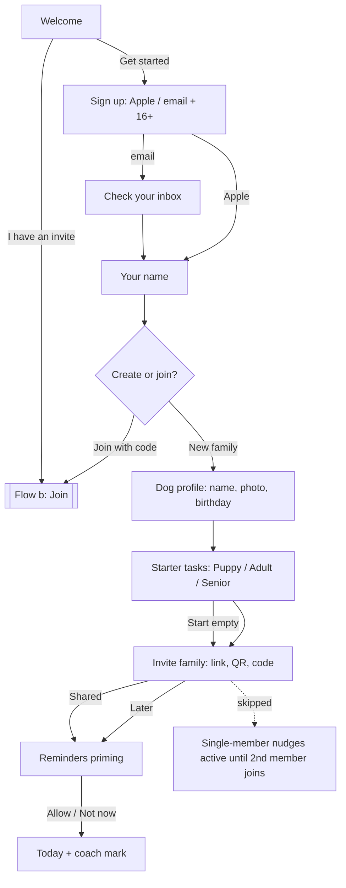
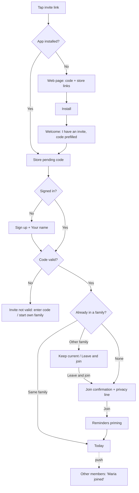
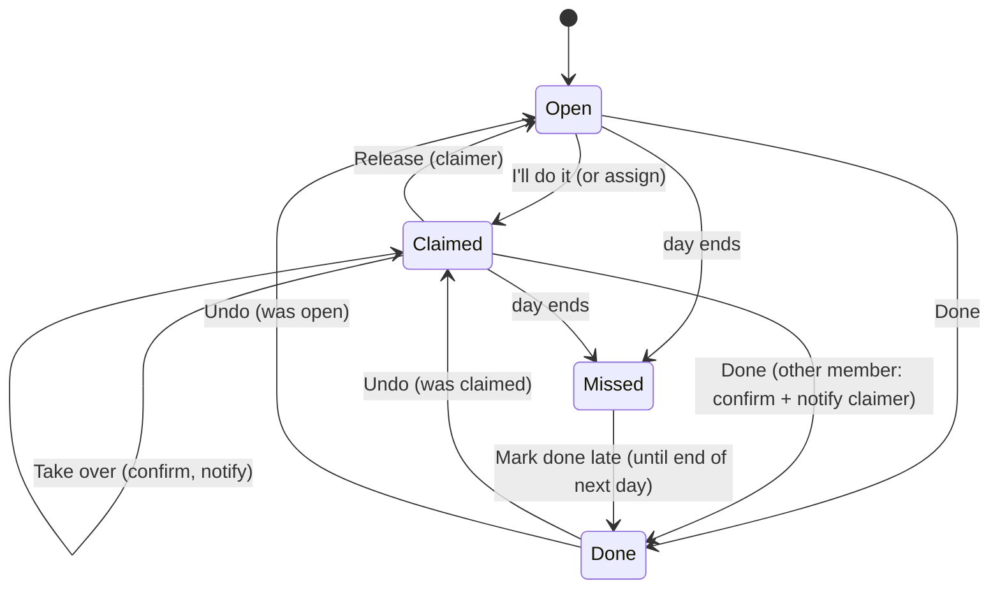
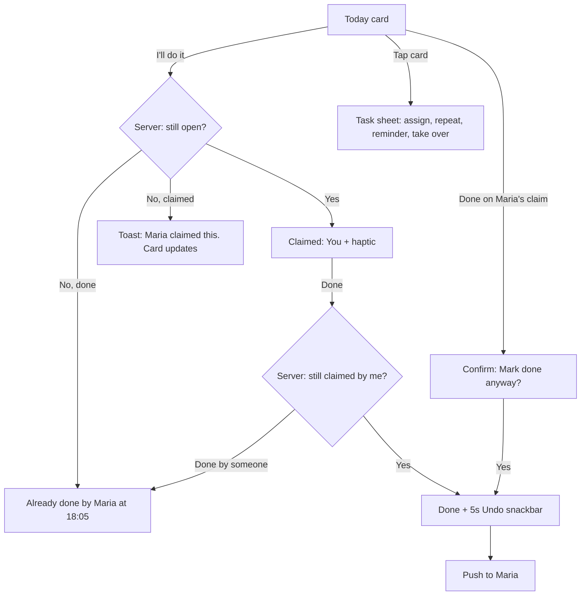
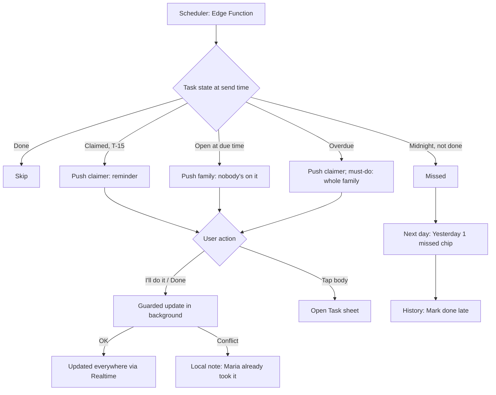
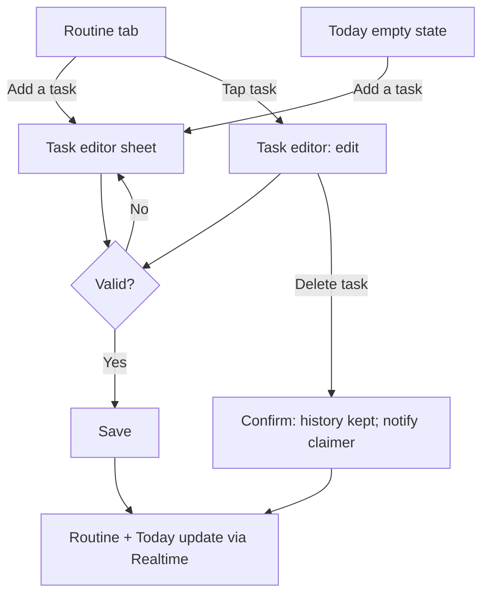
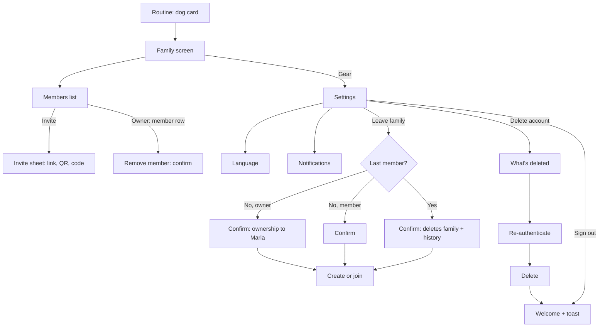

# User Flows (MVP)

Owner: designer · Draft v1 · 2026-10-13 · Sources: `.claude/agents/docs/product-brief.md`, `docs/business/mvp-scope.md`, `docs/business/pricing.md`, `docs/marketing/positioning.md`, current app in `src/`.

Companion doc: [screens.md](screens.md) (screen inventory, navigation map, terminology, EN/GR labels). Screen names in **bold** match the inventory there. User-facing terms follow the terminology section: **task** (not "need"), **claim** / "I'll do it" (not "book"), **Routine** tab (was "Needs"), **Family** (= household).

Visual baseline: [mockups/](mockups/README.md) (Main = Today, Book, Needs, Week, AddNeed). These flows keep the mockups' 3-tab bar and row styles; screens.md §4 lists where the flows ask for changes.

## Design principles for every flow
1. **One tap for the core loop.** Claim and Done are one tap from Today. Options (assign someone else, repeat, reminder) are secondary, in the task sheet.
2. **Never let the dog be fed twice.** Every state change is checked against the latest server state. Conflicts are explained in plain words and name the person ("Maria already fed Max at 18:05").
3. **Always pull in the second person.** While a family has one member, every main screen has a calm, dismissible invite prompt. Activation = family created + 1 member joined within 72h.
4. **Free means no paywall UI at MVP.** Only reserved slots (Family screen "Pack" card, "Add another dog", "Older history"), shown as "Early access: everything is free".
5. **Greek and English from day one.** No copy that needs gendered articles with names (write "Claimed: Maria" / «Ανέλαβε: Μαρία», not «η Μαρία το ανέλαβε»).

## Task status model (shared by all flows)

| State | Meaning | Who sees what on Today |
|---|---|---|
| Open | Scheduled today, nobody claimed | Orange dashed row (mockup `Main`: "Nobody booked · 45 min"), dashed "+" avatar, dark **I'll do it** button. A small **Done** sits in the row's overflow/swipe for "I just did it" |
| Claimed | Someone said "I'll do it" | White row with the claimer's coloured initials avatar, "Maria" / "Claimed: Maria". The claimer sees **Done** (green) and **Release** (in the Task sheet). Everyone else sees no button until due; then **Done** with a confirm step |
| Due | Time reached (open or claimed) | Card gets a "Due now" tag |
| Overdue | Due + grace period (task duration, min 30 min, max 60 min) and not done | Red "Overdue" tag; household nudge sent (flow d) |
| Done | Completed | Done row fill `#E9EDE6`, "Maria · done 18:05" (mockup copy) + **Undo** (rules in flow c) |
| Missed | Day ended without Done | Shown only in **History** (flow f). Can be marked "done late" until the end of the next day |

Engineering note: `set_daily_need_occurrence` currently upserts last-write-wins. Conflict handling below needs a guarded transition: the client sends the status it expects to change from (`expected_status`, plus `expected_actor` for claimed/done), and the server rejects with a typed error (`already_claimed`, `already_done`, `state_changed`) carrying the current row.

---

## (a) First-run onboarding: create family, dog profile, starter tasks, invite

- **Goal:** In under 5 minutes, go from install to a family with a dog, 3+ tasks, and at least 1 invite sent.
- **Entry point:** First app launch with no session (today: `AccountGate` mode `signed-out`).

**Happy path**
1. **Welcome**: "Who's walking the dog? Now everyone knows." Language follows the device, with an EN / ΕΛ switch in the corner. Buttons: **Get started**, **I have an invite** (goes to flow b).
2. **Sign up**: **Continue with Apple** (iOS, first), **Continue with email**. Includes a "I'm 16 or older" checkbox and links to the privacy policy and terms.
3. **Your name**: first name or nickname, pre-filled from the Apple name. Helper text: "Your family sees this name." This replaces today's email-prefix fallback in `setOccurrence`.
4. **Create or join**: "Set up a new family" or "Join with a code".
5. **Dog profile**: name (required), photo (optional: camera or library), birthday (optional, month and year are enough). The family name defaults to "Max's family" and can be edited later.
6. **Starter tasks**: pick one template: Puppy / Adult dog / Senior or on meds. A pre-checked list appears, for example Adult: Morning walk 07:30, Breakfast 08:00, Evening walk 19:00, Dinner 20:00. Each row has a checkbox and a tappable time. Users can add or remove rows here. Footer: "You can change these any time in Routine."
7. **Invite family** (full screen, the key activation step): "Who else looks after Max?" Primary action: **Share invite link** (system share sheet, message pre-written in the user's language). Secondary actions: **Show QR code** (for people in the same room) and the code itself with a copy button. A quiet **I'll do it later** link sits at the bottom.
8. **Reminders priming**: "Get a nudge when it's your turn, or when Max is still waiting." **Turn on reminders** opens the OS prompt; **Not now** skips it.
9. Land on **Today** with a one-time coach mark on the first open task: "Tap 'I'll do it' so your family knows you've got it."

**Edge cases / empty / error**
- **Email unconfirmed:** a "Check your inbox" screen with **Resend** and **Open mail app**. Flow resumes at step 3 after confirmation, keeping any pending invite code.
- **Apple "Hide my email":** works as normal. The name step is required because Apple may not share a name.
- **Under 16:** cannot continue. Show "Ask a parent to add you later." (Managed kid members come in v2.)
- **No template fits:** "Start empty" link. Today then shows an empty state with **Add a task**.
- **Photo permission denied:** keep the paw placeholder and show an inline hint. Never block the flow.
- **Invite skipped:** go on to step 8. Single-member nudges start (see below).
- **Network error on create:** inline error with **Try again**. Entered data is kept.
- **App killed mid-onboarding:** resume at the first incomplete step (server knows whether the family, dog and tasks exist).

**Single-member nudges (until a 2nd member joins)**
| Where / when | Nudge |
|---|---|
| Today header, every launch | Card: "Doing it all yourself? Invite who helps with Max." Buttons: **Invite**, ✕. Dismissing hides it for 24h. After 3 dismissals it shows only on the Family screen and the Routine dog card |
| Task sheet → "Who's doing it" row | A **+ Invite** chip after the member avatars, where sharing the load is felt |
| After the 3rd completion | Snackbar: "Nice! Want the family to see this? **Invite**" |
| Push at +24h and +60h (inside the 72h activation window), only if still solo | "Max's evening walk is open. Share it with your family?" Opens **Invite** |
| Week tab, solo | Empty member legend replaced with "Add family to see who does what this week" |
| Routine dog card + Family screen | Members section shows "Just you so far" with a prominent **Invite** |



---

## (b) Join a family via invite link or code

- **Goal:** An invited person sees today's tasks within about 60 seconds of tapping the link.
- **Entry points:** an invite link (`https://<domain>/j/<CODE>`, a universal or app link); **Welcome → I have an invite**; **Create or join → Join with code**.

**Happy path (app installed, link tapped)**
1. The link opens the app and the code is stored locally as a *pending invite*.
2. If there is no session, go to **Sign up** → **Your name**. The "create or join" step is skipped.
3. **Join confirmation**: dog photo and name, member avatars ("Eleni, Nikos"), and the line "Your family will see your name and the tasks you claim or complete." Button: **Join Max's family**.
4. **Reminders priming** (same screen as flow a, step 8).
5. **Today**, with a welcome toast. Existing members get a push: "Maria joined Max's family 🎉".

**App not installed**
- The link opens a web landing page with store badges, the code in large text, and a "Copy code" button. After install, **Welcome → I have an invite** pre-fills the code from the clipboard if it looks like a code (with an iOS paste prompt). Deferred deep linking is nice to have, not required for MVP.

**Edge cases / errors**
- **Invalid or reset code:** "This invite doesn't work anymore. Ask your family for a new link." Offer **Enter a code** or **Start my own family**.
- **Already in a family** (one family per user): "You're already in Bella's family. You can be in one family at a time." Buttons: **Keep Bella's family** / **Leave and join Max's**. If the user is the *only* member of the current family, warn that its tasks and history will be deleted.
- **Already a member of this family:** go straight to Today.
- **Code typed by hand:** case-insensitive and ignores spaces. Ambiguous characters (O/0, I/1) are not used when generating codes.
- **Join fails on the network:** keep the pending invite and show **Try again**.



---

## (c) Daily loop: Today → claim → complete

- **Goal:** In one tap, say "I've got this" before doing a task, and mark it done after, so nobody repeats it or assumes someone else did it.
- **Entry point:** the Today tab (`src/app/(tabs)/index.tsx` → `today-list.tsx`), a push (flow d), or the Week grid.

**Happy path**
1. Today shows "Max's day" with the dog photo, progress ("3 of 6 done · 3 open"), the NOW line, and a timeline of tasks.
2. On an open (orange dashed) task, the user taps **I'll do it**. Optimistic UI turns the row white with the user's avatar, plus a light haptic. Everyone else sees the change live via Realtime. The default reminder is 15 minutes before (uses `reminder_enabled`).
3. Later, the user taps **Done**. The card goes muted: "You · 18:05". A snackbar offers **Undo** for 5 seconds.
4. Optional (family activity push, default on for must-do tasks only): "Nikos fed Max (Dinner)".

**Secondary path: claim options.** Tapping the card body (not the button) opens the **Task sheet** (today's `book-task`, mockup `Book`). The mockup's helper copy "When you're back, tap Done and add a note" must drop "add a note" at MVP, because task notes are v1.1. It shows details and notes, **Who's doing it** (assign to a member, or **+ Invite**), **Repeat** (Just today / Every Tue / Every day), and **Remind me 15 min before**. Claiming *for* someone sends them a push: "Eleni signed you up for the Evening walk at 19:00".

**Changes from the current app**
- Every task type can be claimed, not only future walks. Today, `today-list.tsx` shows **Book** only for `walk` tasks at or after now.
- Only the claimer can **Release** a claim (today: "Cancel"). Others use **Take over** in the sheet, with a confirm step, and the original claimer is notified.

**Conflicts and edge cases**
| Situation | Behaviour |
|---|---|
| **Two people claim at once** | The server accepts the first write. The second person's card snaps to the winner's state, with a toast: "Maria claimed this a moment ago." No error styling, because nothing went wrong |
| **Completing a task someone else claimed** | Allowed, since the dog comes first. An inline confirm on the card reads "Maria claimed this. Mark it done anyway?" with **Mark done** / **Cancel**. Maria gets a push: "Nikos did the Evening walk you claimed", so she doesn't do it again |
| **Tapping Done on a task already done (stale screen)** | Blocked with a prominent message: "Already done by Maria at 18:05." For food and medicine tasks, add "Don't feed / give again." This is the double-feeding guard |
| **Claiming a task that's already done** | Same guard; the card refreshes to Done |
| **Undo own completion** | Snackbar Undo for 5s. After that, **Undo** stays on the card until midnight for the person who completed it. The task returns to its previous state (claimed by them, or open) |
| **Undo someone else's completion** | In the task sheet only: "Mark as not done" with a confirm. The completer is notified. This prevents casual taps from erasing someone's work |
| **Release a claim** | Claimer only. The task returns to open. If it's within 30 minutes of the due time, the household gets "Evening walk is open again" |
| **Take over a claim** | Task sheet → **Take over** → confirm. The original claimer is notified |
| **Offline** | Banner: "You're offline. Changes will save when you reconnect." Claim and Done are **disabled** while offline: queued claims cause false certainty, which is the very problem we solve. Reading still works from cache |
| **Action fails** | Optimistic change rolls back and a toast shows "Couldn't save. Try again" with a retry button. This replaces today's raw error text in the list header |
| **No tasks today** | "Nothing scheduled for Max today." **Add a task** opens the task editor |
| **All done** | Progress card changes to "All done for today 🐾 · 4 by Maria, 2 by you" (light reward that reinforces sharing) |
| **Task edited while claimed** | The claim is kept. If the time moved, the claimer is told "Evening walk moved to 19:30" |





---

## (d) Reminder → act from the notification; missed-task handling

- **Goal:** Nothing gets missed silently. The right person gets a nudge, and can act without opening the app.
- **Entry points:** a push notification (server-scheduled by an Edge Function, not only local), Today.

**Notification types (MVP)**
| Trigger | Recipient | Copy (EN) | Actions |
|---|---|---|---|
| 15 min before a claimed task (if reminder on) | Claimer | "Evening walk at 19:00. You've got this one." | **Done** · Open |
| **Must-do** task still unclaimed 1h before due (rule from mockup `AddNeed`: "Alerts everyone if it isn't booked 1 hour before") | All members | "Max's medicine at 09:00 has nobody on it yet." | **I'll do it** · Open |
| Due time, task still unclaimed | All members (except anyone who muted "Open tasks") | "Max's dinner is due and nobody's on it." | **I'll do it** · Open |
| Overdue (due + grace) and not done | Claimer; for must-do tasks, also the whole family | "Max's medicine is overdue." | **Done** · Open |
| Someone completed a task you claimed | Claimer | "Nikos did the Evening walk you claimed." | Open |
| You were assigned a task | Assignee | "Eleni signed you up for the Evening walk, 19:00." | Open |
| New member joined | All | "Maria joined Max's family." | Open |
| Solo nudge (+24h, +60h) | Solo owner | See flow a | Invite |

**Happy path (act from the notification)**
1. A push arrives: "Max's dinner is due and nobody's on it."
2. Long-press (iOS) or expand (Android), then tap **I'll do it**. The app handles this in the background with the same guarded call as flow c.
3. A silent confirmation follows (Android shows an updated notification; iOS relies on the absence of an error). If the action conflicts, a follow-up local notification says "Maria already took it."
4. Tapping the notification body opens the **Task sheet** for that task, over Today.

**Missed-task handling**
- After the overdue push, the card stays on Today with an "Overdue" tag until midnight. It can still be claimed or done.
- At day end, unfinished tasks become **Missed**. Next morning, Today shows a small chip: "Yesterday: 1 missed. Review." It opens **History** filtered to yesterday.
- **Mark done late** in History (until the end of the next day). This handles "I did it, I just forgot to tick it", so the history isn't wrongly marked as missed. The completion time is recorded as "logged late".
- No daily nagging digest at MVP.

**Edge cases**
- **Notifications off at OS level:** a persistent but dismissible banner on Today ("Reminders are off. Turn on"), and a status row in Notification settings with a deep link to OS settings.
- **Task already done when the push arrives:** the server cancels scheduled pushes on state change. If a push still lands, its action returns "Already done by Maria."
- **Quiet hours:** MVP uses a fixed default, with no pushes from 23:00 to 07:00 except for claimer reminders the user set. Per-member custom quiet hours and missed-task escalation (backup person) are **Pack in v1.1**.
- **Android OEM battery killers** (Xiaomi, Samsung): a one-time "Make sure reminders arrive" help card in Notification settings.
- **Signed out on the device:** pushes for that device token stop (token removed on sign-out).



---

## (e) Create / edit a recurring task

- **Goal:** Add or change a repeating task in under 30 seconds.
- **Entry points:** Routine tab → **Add a task** / tap a task; Today empty state → **Add a task**; onboarding templates (bulk create).
- **Current implementation:** the `NeedForm` modal in `daily-needs-screen.tsx` (type chips, name, time with ±5 and presets, duration, repeat days, Must do, notes). Visual baseline: mockup `AddNeed` (sheet). Its type-dependent **amount** row (Food: 100/150/200 g; Medicine: 1 pill / 2 pills / Drops; others: duration) is adopted here. Today's code stores only `duration_minutes`, so amount needs a field (engineer).

**Happy path (create)**
1. Routine → **Add a task**. The editor opens as a sheet.
2. Pick a **type**: Walk, Meal (was "Food"), Medicine, Potty, Play, Grooming, Vet, Other. The name auto-fills from the type ("Evening walk" by time of day) until the user edits it.
3. Set the **time** (presets Morning / Midday / Evening / Night, or ±5 min), **amount or duration** (by type), and **repeat** (Every day / Weekdays / Weekends / custom days).
4. Optional: **Must do** (alerts everyone if unclaimed 1h before, and escalates to the family when overdue), **Usually done by** (a default assignee, which pre-claims each day so the person can release it), **Remind before** (default on, 15 min), and **Notes**.
5. Tap **Add to Max's day**. The task appears in Routine and, if scheduled today, on Today with a highlight animation.

**Edit / delete**
- Tap a task in Routine to open the same editor with **Save changes**. Changes apply to today's unfinished occurrence and all future ones. Past and done occurrences are never rewritten.
- **Delete task** (new; missing today): opens a confirm: "Delete 'Evening walk'? It disappears from today and future days. History is kept." If the task is claimed today, add "Maria has claimed it today. She'll be notified."
- **Pause** is a v1.1 idea (for example, while the dog is at the groomer for a week). Not in MVP.

**Edge cases / validation**
- **Empty name:** "Give this task a name." **No days:** "Choose at least one day." (Both exist today.)
- **Two tasks at the same time:** allowed, with no warning.
- **Vet visit** (a single date, not recurring): MVP supports a "Just once on <date>" repeat option, which covers vet and grooming appointments from the brief.
- **Time moved earlier than now while claimed today:** keep the claim and notify the claimer.
- **Concurrent edits by two members:** last save wins. The sheet shows "Updated by Maria just now" if the task changed while it was open, and offers **Reload**.



---

## (f) View 7-day history

- **Goal:** Answer "Did anyone give Max his pill yesterday?" and "Who's been doing the walks?"
- **Entry points:** Today header **History** (clock icon); Family screen → **History**; "Yesterday: 1 missed" chip; tapping a past day in Week.

**Happy path**
1. **History** shows a summary strip for the last 7 days: "38 of 42 done", plus per-member counts (Maria 18 · Nikos 14 · You 6), which shows that care is shared.
2. A list grouped by day (Today, Yesterday, Mon 11 Oct, …). Each row shows the task, time, outcome ("Maria · 18:05", "Missed", or "Logged late by Nikos"), and a type badge.
3. A filter chip row: All · Missed · By member.
4. Tap a **Missed** row from today or yesterday → **Mark done late** (flow d).

**Edge cases**
- **Family younger than 7 days:** show the days that exist, plus a footer line: "History starts when Max joined Dog Schedule."
- **Empty day:** "No tasks scheduled."
- **Member left the family:** their completions stay, shown as "Former member".
- **Future slot (v1.1, Pack):** after day 7, a locked row "Older history and monthly recap" leads to the paywall. **Hidden at MVP.** The data is retained (`pricing.md` §7), so upgrading reveals the past.

```mermaid
flowchart LR
  T[Today: History icon] --> H[History: last 7 days]
  F[Family screen: History] --> H
  Y[Yesterday missed chip] --> H
  W[Week: tap past day] --> H
  H -->|Filter| H
  H -->|Missed row, today or yesterday| L[Mark done late] --> H
  H -.v1.1 Pack.-> P[Older history: paywall]
```

---

## (g) Settings: language, notifications, members, leave family, delete account

- **Goal:** Manage personal preferences and family membership. Meet App Store / Play rules on account deletion and GDPR.
- **Entry point:** Routine tab (mockup `Needs`) → dog card → **Family** screen → gear → **Settings**. There is also a gear in the Routine tab header. The mockups' 3-tab bar is kept; Family is a pushed screen, not a 4th tab. Members and invites live on the Family screen. Today, sign-out and the invite code sit in the header of the Needs tab (`daily-needs-screen.tsx`); they move to Family and Settings.

**Settings structure**
- **Profile:** display name, email or "Signed in with Apple".
- **Language:** System / English / Ελληνικά. Switching applies immediately, with no restart. Dates use `el-GR` or `en-GB`.
- **Notifications:** OS status row; toggles for *My claimed tasks* (on), *Open tasks nobody's on* (on), *Overdue tasks* (on), *Family activity* (must-do only by default), *New members* (on). Fixed quiet-hours note: "No reminders 23:00–07:00 (custom times coming with Pack)."
- **Family:** rename family, **Leave family**.
- **Account:** Sign out, **Delete account**.
- **About:** privacy policy, terms, contact support, app version.

**Members (Family screen)**
- Each member is listed with an avatar, name, and role (Owner / Member). A **You** label marks the current user.
- **Invite** opens the share link, QR code, or code. The owner can **Reset invite link**, which invalidates the old link.
- The owner can **Remove** a member via the member row action sheet, with a confirm: "Remove Nikos? He'll lose access to Max's schedule." The removed member sees a "You were removed from Max's family" screen, then **Create or join**.

**Leave family**
1. Settings → Leave family → confirm sheet: "You'll stop seeing Max's schedule and reminders. Your past completions stay in the family's history."
2. **If the user is the owner and other members exist:** ownership moves automatically to the longest-standing member, and the sheet names them ("Maria will become the owner").
3. **If the user is the last member:** "This deletes Max's family, tasks and history. This can't be undone." The confirm button is red.
4. Afterwards: **Create or join** screen.

**Delete account** (store requirement; reachable within 2 taps of Settings)
1. Settings → **Delete account** → info screen: what is deleted (account, name, devices) and what stays (completions show as "Former member"). Owner transfer and last-member rules match Leave family.
2. Re-authentication: Apple users go through the Apple re-auth sheet, and the server revokes the Apple token. Email users enter their password.
3. **Delete my account** (red) → signed out → Welcome screen with a toast: "Your account was deleted."
- **Edge cases:** an offline attempt is blocked with a message. A server failure shows "We couldn't delete your account. Try again or contact support" with the support email. Data export is on request via support at MVP, linked from the same screen.


